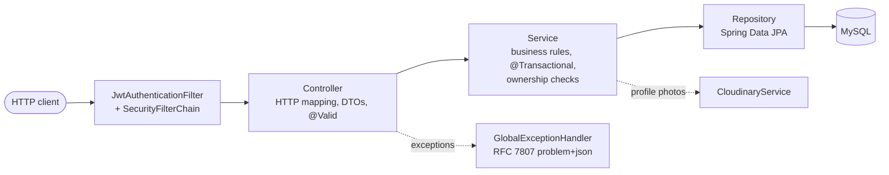
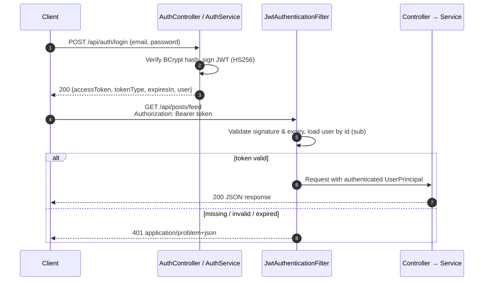

<div align="center">

# 🌐 True Social

### A secure, well-tested social media REST API built with Java 17 & Spring Boot 3

<p>
  
  
  
  
</p>
<p>
  
  
  
  
</p>

<p>
  <a href="#overview">Overview</a> •
  <a href="#features">Features</a> •
  <a href="#architecture">Architecture</a> •
  <a href="#api-reference">API</a> •
  <a href="#getting-started">Getting Started</a> •
  <a href="#testing">Testing</a>
</p>

</div>

---

<a id="overview"></a>

## 📖 Overview

**True Social** is the backend of a social network, exposed as a stateless JSON REST API. Users register, publish posts, comment, like, follow each other, read a personalized feed, bookmark posts, block users, and receive in-app notifications.

It is an **independently built portfolio project**, not a commercial product, and there is no hosted deployment. Its purpose is to show solid backend engineering fundamentals:

- a clean, feature-organized **layered architecture** (Controller → Service → Repository)
- **stateless JWT authentication** and **ownership- and role-based authorization**
- **DTOs and Bean Validation** at every API boundary, so entities and secrets never leak
- consistent **RFC 7807** error responses, including for 401 / 403
- **efficient queries** (no N+1 on paginated lists) and a safe pagination/sorting contract
- an automated test suite of **unit and integration tests** that runs without an external database

---

<a id="features"></a>

## ✨ Features

<table>
<tr>
<td valign="top" width="50%">

#### 🔐 Authentication & Account
- Register and log in; both return a signed, expiring **JWT**
- Passwords hashed with **BCrypt**; emails trimmed and lower-cased
- View and partially update your profile (name, email, bio)
- Change password (current password required)
- **Profile photo upload** to Cloudinary — JPEG, PNG, WEBP or GIF, max 5 MB

#### 👤 Users
- Public profiles with follower, following and post counts, plus "followed by me"
- Emails stay private: returned only on your own profile
- Case-insensitive search by name, paginated

#### 📝 Posts & Feed
- Create, read, partially update and delete posts
- Only the **author or an admin** can edit or delete
- Paginated, sortable lists: all posts, a user's posts, and a **personalized feed** (your posts + people you follow)
- Every post includes like count, comment count and "liked by me"

</td>
<td valign="top" width="50%">

#### 💬 Comments & ❤️ Likes
- Comment CRUD with pagination
- Comment author edits; comment author, **post author** or admin deletes
- Like / unlike — one like per user, enforced by a unique constraint

#### 👥 Follows & 🚫 Blocking
- Follow / unfollow; paginated followers and following lists; no self-follow
- Block / unblock and list blocked users
- Blocking removes follows in **both directions** and prevents re-following

#### 🔖 Saved Posts
- Bookmark posts to a private list, most-recently-saved first
- One save per post per user; deleting a post removes it from every list

#### 🔔 Notifications
- Created on **like, comment and follow** — never for your own actions
- List all or unread only, unread count, mark one / all as read

#### 🛡️ Administration
- `ROLE_USER` and `ROLE_ADMIN` seeded automatically at startup
- Role management API restricted to admins via `@PreAuthorize`

</td>
</tr>
</table>

> [!NOTE]
> **Blocking does not hide content yet.** Posts, comments and profiles of blocked users still appear in feeds, post lists and search results. See [Known limitations](#known-limitations).

---

## 🧰 Tech Stack

| Category | Technologies |
|---|---|
| **Language & Runtime** |  |
| **Backend Framework** |  Spring Web · Spring Data JPA · Bean Validation |
| **Security & Auth** |   BCrypt |
| **Database & Persistence** |   |
| **Cloud & File Storage** |  (profile photos, optional) |
| **Testing** |  Mockito · AssertJ · Spring MockMvc · spring-security-test · H2 (in-memory) |
| **Build & Tooling** |  Lombok · Spring Boot DevTools |

---

<a id="architecture"></a>

## 🏗️ Architecture

A classic **layered Spring Boot application**, organized **by feature**. Each feature package owns its controller, service, repository, entities and DTOs.

### Request flow



### Authentication flow



### Package structure

```text
src/main/java/com/example/Social_Media_RestApi_Project
├── auth/            register & login (controller, service, DTOs)
├── user/            profiles, search, password, profile photo
├── post/            posts, likes, saved posts, feed (Post, PostLike, SavedPost)
├── comment/         comments on posts
├── follow/          follow / unfollow, followers & following lists
├── block/           block / unblock users, blocked-users list
├── notification/    in-app notifications
├── role/            roles + startup data initializer (admin-only API)
├── security/        SecurityConfig, JWT service & filter, UserPrincipal, CurrentUserProvider
├── storage/         Cloudinary image upload
├── config/          Cloudinary configuration properties
├── exception/       custom exceptions + GlobalExceptionHandler (RFC 7807)
└── common/          BaseEntity (id + audit timestamps), PageResponse, SortValidator
```

### Key design decisions

- **DTOs everywhere.** Entities are never serialized directly, so password hashes and private emails can't leak. Request and response DTOs are Java `record`s.
- **Identity comes from the token, never the request body.** Authors of posts and comments are always the authenticated user. `CurrentUserProvider.canModify(ownerId)` centralizes the "owner or admin" rule.
- **Consistent errors.** Every error is an RFC 7807 `application/problem+json` body, including Spring Security's 401 and 403.
- **No N+1 queries on lists.** Post pages fetch authors with `@EntityGraph`; like counts, comment counts and "liked by me" are loaded with one aggregate query each per page.
- **Stable pagination contract.** Lists return a `PageResponse` (`content, page, size, totalElements, totalPages, first, last`). Page size is capped at 50 and sorting is restricted to an allow-list (`SortValidator`).
- **Stateless security.** No HTTP session. The JWT subject is the user id, so changing your email doesn't invalidate your token.
- **Secrets from the environment.** JWT secret, database credentials and Cloudinary keys are never stored in the repository.

---

## 🔐 Authentication & Authorization

1. **Register or log in** — `POST /api/auth/register` or `POST /api/auth/login` returns a JWT signed with HMAC-SHA256. It contains the user id (subject), email and roles, and expires after `JWT_EXPIRATION` (default 1 hour).
2. **Send the token** with every other request:
   ```http
   Authorization: Bearer <token>
   ```
3. **`JwtAuthenticationFilter`** checks the signature and expiry, loads the user and populates the Spring Security context. The API is stateless — no session, no cookies — so CSRF protection is disabled.

| Rule | How it is enforced |
|---|---|
| Everything except register / login needs a token | `SecurityFilterChain` — missing, invalid or expired token → **401** |
| Only owners (or admins) change their content | `CurrentUserProvider.canModify(ownerId)` in the services → otherwise **403** |
| A post's author can delete comments on their post | `CommentService.deleteComment` |
| Your own data is resolved from the token | `/me` endpoints, saved posts, blocks and notifications never take a user id from the client |
| Role administration is admin-only | `@PreAuthorize("hasRole('ADMIN')")` on `RoleController` |

---

<a id="api-reference"></a>

## 📡 API Reference

All endpoints except register and login require `Authorization: Bearer <token>`.
List endpoints accept `?page=0&size=10&sort=createdAt,desc` (max page size 50).

<details open>
<summary><b>🔑 Authentication</b></summary>

| Method | Endpoint | Description | Success |
|---|---|---|---|
| `POST` | `/api/auth/register` | Create an account, returns a token | 201 |
| `POST` | `/api/auth/login` | Log in, returns a token | 200 |

</details>

<details>
<summary><b>👤 Users & Account</b></summary>

| Method | Endpoint | Description | Success |
|---|---|---|---|
| `GET` | `/api/users?query=ali` | List or search users by name (sort: `name`, `createdAt`) | 200 |
| `GET` | `/api/users/me` | My profile (includes email) | 200 |
| `PATCH` | `/api/users/me` | Update name / email / bio (partial) | 200 |
| `PUT` | `/api/users/me/password` | Change password | 204 |
| `POST` | `/api/users/me/profile-photo` | Upload profile photo (`multipart/form-data`, field `file`) | 200 |
| `GET` | `/api/users/{userId}` | Public profile | 200 |
| `GET` | `/api/users/{userId}/posts` | Posts of a user | 200 |

</details>

<details>
<summary><b>📝 Posts</b></summary>

| Method | Endpoint | Description | Success |
|---|---|---|---|
| `GET` | `/api/posts` | All posts (sort: `createdAt`, `updatedAt`, `title`) | 200 |
| `GET` | `/api/posts/feed` | My posts plus posts of users I follow | 200 |
| `GET` | `/api/posts/{postId}` | A single post | 200 |
| `POST` | `/api/posts` | Create a post (returns a `Location` header) | 201 |
| `PATCH` | `/api/posts/{postId}` | Edit a post (author or admin) | 200 |
| `DELETE` | `/api/posts/{postId}` | Delete a post with its comments, likes and notifications (author or admin) | 204 |

</details>

<details>
<summary><b>💬 Comments</b></summary>

| Method | Endpoint | Description | Success |
|---|---|---|---|
| `GET` | `/api/posts/{postId}/comments` | Comments of a post (sort: `createdAt`, `updatedAt`) | 200 |
| `POST` | `/api/posts/{postId}/comments` | Add a comment | 201 |
| `GET` | `/api/posts/{postId}/comments/{commentId}` | A single comment | 200 |
| `PATCH` | `/api/posts/{postId}/comments/{commentId}` | Edit (comment author or admin) | 200 |
| `DELETE` | `/api/posts/{postId}/comments/{commentId}` | Delete (comment author, post author or admin) | 204 |

</details>

<details>
<summary><b>❤️ Likes</b></summary>

| Method | Endpoint | Description | Success |
|---|---|---|---|
| `POST` | `/api/posts/{postId}/like` | Like a post | 204 |
| `DELETE` | `/api/posts/{postId}/like` | Remove a like | 204 |

</details>

<details>
<summary><b>👥 Follows</b></summary>

| Method | Endpoint | Description | Success |
|---|---|---|---|
| `POST` | `/api/users/{userId}/follow` | Follow a user | 204 |
| `DELETE` | `/api/users/{userId}/follow` | Unfollow a user | 204 |
| `GET` | `/api/users/{userId}/followers` | Followers | 200 |
| `GET` | `/api/users/{userId}/following` | Users followed | 200 |

</details>

<details>
<summary><b>🔔 Notifications</b></summary>

| Method | Endpoint | Description | Success |
|---|---|---|---|
| `GET` | `/api/notifications?unreadOnly=false` | My notifications, newest first | 200 |
| `GET` | `/api/notifications/unread-count` | Number of unread notifications | 200 |
| `PATCH` | `/api/notifications/{notificationId}/read` | Mark one as read | 204 |
| `PATCH` | `/api/notifications/read-all` | Mark all as read | 204 |

</details>

<details>
<summary><b>🔖 Saved Posts</b></summary>

| Method | Endpoint | Description | Success |
|---|---|---|---|
| `POST` | `/api/posts/{postId}/save` | Save a post | 204 |
| `DELETE` | `/api/posts/{postId}/save` | Remove a post from my saved list | 204 |
| `GET` | `/api/users/me/saved-posts` | My saved posts, most recently saved first | 200 |

</details>

<details>
<summary><b>🚫 Blocking</b></summary>

| Method | Endpoint | Description | Success |
|---|---|---|---|
| `POST` | `/api/users/{userId}/block` | Block a user | 204 |
| `DELETE` | `/api/users/{userId}/block` | Unblock a user | 204 |
| `GET` | `/api/users/me/blocked` | Users I have blocked | 200 |

</details>

<details>
<summary><b>🛡️ Roles (admin only)</b></summary>

| Method | Endpoint | Description | Success |
|---|---|---|---|
| `GET` | `/api/roles` | List roles | 200 |
| `POST` | `/api/roles` | Create a role, e.g. `ROLE_MODERATOR` | 201 |

</details>

### Example requests

```bash
# Register
curl -X POST http://localhost:8080/api/auth/register \
  -H "Content-Type: application/json" \
  -d '{"name":"Ali Kassab","email":"ali@example.com","password":"password123"}'
```

```json
{
  "accessToken": "eyJhbGciOiJIUzI1NiJ9...",
  "tokenType": "Bearer",
  "expiresIn": 3600,
  "user": { "id": 1, "name": "Ali Kassab", "profileImageUrl": null }
}
```

```bash
# Create a post
curl -X POST http://localhost:8080/api/posts \
  -H "Authorization: Bearer $TOKEN" -H "Content-Type: application/json" \
  -d '{"title":"Hello","content":"My first post"}'
```

```bash
# Read my feed, 5 posts per page
curl "http://localhost:8080/api/posts/feed?page=0&size=5" -H "Authorization: Bearer $TOKEN"
```

<details>
<summary>Example feed response</summary>

```json
{
  "content": [
    {
      "id": 7,
      "title": "Hello",
      "content": "My first post",
      "author": { "id": 1, "name": "Ali Kassab", "profileImageUrl": null },
      "likeCount": 3,
      "commentCount": 1,
      "likedByCurrentUser": false,
      "createdAt": "2026-01-10T12:00:00Z",
      "updatedAt": "2026-01-10T12:00:00Z"
    }
  ],
  "page": 0, "size": 5, "totalElements": 1, "totalPages": 1, "first": true, "last": true
}
```

</details>

---

## ⚠️ Error Handling

All errors use [RFC 7807](https://www.rfc-editor.org/rfc/rfc7807) problem details, produced by `GlobalExceptionHandler` and, for 401 / 403, by `RestAuthenticationEntryPoint` and `RestAccessDeniedHandler`:

```json
{
  "type": "about:blank",
  "title": "Bad Request",
  "status": 400,
  "detail": "Validation failed",
  "instance": "/api/auth/register",
  "errors": { "email": "Email must be a valid email address" }
}
```

| Status | When |
|---|---|
| **400** | Validation errors, malformed JSON, business-rule violations, unsupported sort |
| **401** | Missing, invalid or expired token, or wrong login credentials |
| **403** | Modifying someone else's resource, a missing role, or following a blocked user |
| **404** | Resource not found |
| **409** | Duplicate email, duplicate like / follow / save / block, existing role |
| **413** | Uploaded file too large |
| **502** | Image storage unavailable or not configured |

---

<a id="getting-started"></a>

## 🚀 Getting Started

### Prerequisites

- **JDK 17** or newer
- **MySQL 8** running locally (or anywhere reachable)
- Maven is **not** required — the `./mvnw` wrapper is included

### 1. Clone the repository

```bash
git clone https://github.com/ali-kassab/True-Social.git
```

```bash
cd True-Social
```

> [!TIP]
> On Linux / macOS, if `./mvnw` fails with *Permission denied*, make the wrapper executable with `chmod +x mvnw` (or run it as `sh mvnw ...`).

### 2. Set up the database

1. Install and start **MySQL 8**.
2. Create a database user, or use an existing one.
3. Point `DB_URL`, `DB_USERNAME` and `DB_PASSWORD` at it.

The default URL uses `createDatabaseIfNotExist=true`, so the `RestApiDB` schema is created automatically if the user has permission. Hibernate then creates or updates the tables on startup (`ddl-auto=update`).

### 3. Configure environment variables

All configuration is read from environment variables — **no secrets are stored in the repository**. [`.env.example`](.env.example) lists every variable with placeholder values. Copy it to `.env` (ignored by Git), then export the variables or load the file in your IDE run configuration. Spring Boot does **not** read `.env` files on its own.

| Variable | Required | Default | Description |
|---|---|---|---|
| `JWT_SECRET` | **yes** | – | HMAC key for signing tokens, at least 32 characters (e.g. `openssl rand -base64 48`) |
| `JWT_EXPIRATION` | no | `1h` | Token lifetime (`30m`, `2h`, `1d`, ...) |
| `DB_URL` | no | `jdbc:mysql://localhost:3306/RestApiDB?createDatabaseIfNotExist=true` | JDBC URL |
| `DB_USERNAME` | no | `root` | Database user |
| `DB_PASSWORD` | no | *(empty)* | Database password |
| `CLOUDINARY_CLOUD_NAME` | no | *(empty)* | Cloudinary credentials. If missing, photo uploads return `502`; everything else still works |
| `CLOUDINARY_API_KEY` | no | *(empty)* | |
| `CLOUDINARY_API_SECRET` | no | *(empty)* | |
| `PORT` | no | `8080` | HTTP port |

> [!IMPORTANT]
> The application refuses to start if `JWT_SECRET` is missing or shorter than 32 bytes.

### 4. Run the application

```bash
export JWT_SECRET="change-me-to-a-long-random-string-of-32+-chars"
export DB_USERNAME=root
export DB_PASSWORD=your-local-password
./mvnw spring-boot:run
```

On Windows PowerShell, use `$env:JWT_SECRET="..."` instead of `export`, and `mvnw.cmd` instead of `./mvnw`.

The API is now available at `http://localhost:8080`. The roles `ROLE_USER` and `ROLE_ADMIN` are inserted automatically.

### 5. Build an executable jar (optional)

This also runs the tests:

```bash
./mvnw clean package
```

```bash
java -jar target/Social_media_RestApi_Project-0.0.1-SNAPSHOT.jar
```

### Make a user an admin

There is intentionally no public endpoint for this. Grant the role in the database:

```sql
INSERT INTO user_roles (user_id, role_id)
SELECT u.id, r.id FROM users u, roles r
WHERE u.email = 'you@example.com' AND r.name = 'ROLE_ADMIN';
```

---

<a id="testing"></a>

## 🧪 Testing

```bash
./mvnw clean test
```

The tests need **no MySQL server**: they run against an in-memory **H2** database in MySQL compatibility mode, configured in [`src/test/resources/application.properties`](src/test/resources/application.properties). The suite currently contains **77 tests** across 11 test classes, all passing.

| Test class | Type | What it covers |
|---|---|---|
| `PostServiceTest` | unit (Mockito) | author taken from the token, ownership checks, partial update, cascading delete |
| `PostLikeServiceTest` | unit | like / unlike, duplicate like, notification |
| `CommentServiceTest` | unit | comment ownership (regression test for the old inverted check), post-author moderation |
| `FollowServiceTest` | unit | follow / unfollow rules, self-follow, duplicates, blocked users |
| `SavedPostServiceTest` | unit | save / unsave, duplicate saves, missing posts |
| `BlockServiceTest` | unit | block / unblock, self-block, duplicates, follows removed on block |
| `UserServiceTest` | unit | profile privacy, profile update, password change rules |
| `AuthServiceTest` | unit | registration: hashing, default role, duplicate email |
| `NotificationServiceTest` | unit | no self-notifications, users can only read their own notifications |
| `JwtServiceTest` | unit | valid, expired, tampered and malformed tokens, minimum secret length |
| `SocialApiIntegrationTest` | integration (MockMvc + H2) | full HTTP flows through the real security filter chain |

---

## 🔒 Security Considerations

- **Password storage** — BCrypt hashes only; passwords are never returned by the API.
- **Token signing** — HS256 with a secret of at least 32 bytes, validated at startup.
- **No mass assignment of identity** — user ids for "my" data and authorship always come from the authenticated principal.
- **Private data** — emails are returned only on your own profile; entities are never serialized directly.
- **Sort injection protection** — client sort properties are restricted to an allow-list, so private fields like `password` can't be used to infer ordering.
- **Upload validation** — content type allow-list (JPEG, PNG, WEBP, GIF) and a 5 MB size limit.
- **Secrets** — read from environment variables; `.env` and key files are git-ignored.

---

<a id="known-limitations"></a>

## ⚠️ Known Limitations

- **Blocking does not hide content.** Posts, comments and profiles of blocked users still appear in feeds, post lists and search results. Blocking currently removes follows in both directions and prevents following.
- No refresh token and no server-side logout — a token stays valid until it expires.
- The schema is managed by Hibernate `ddl-auto=update` rather than versioned migrations.
- No rate limiting on login.
- Notifications are polled through the REST API; there are no real-time push notifications.
- Accounts created before roles were assigned automatically may have no role. They can be fixed with:
  ```sql
  INSERT INTO user_roles (user_id, role_id)
  SELECT u.id, r.id FROM users u JOIN roles r ON r.name = 'ROLE_USER'
  WHERE NOT EXISTS (SELECT 1 FROM user_roles ur WHERE ur.user_id = u.id);
  ```

---

## 🗺️ Future Improvements

> These are **planned ideas, not implemented features.**

- [ ] Filter blocked users' posts, comments and profiles out of feeds, lists and search
- [ ] Refresh tokens and token revocation / logout
- [ ] Versioned database migrations with Flyway or Liquibase
- [ ] Rate limiting on authentication endpoints
- [ ] OpenAPI / Swagger UI documentation
- [ ] Docker Compose setup for the app and MySQL
- [ ] CI pipeline (GitHub Actions) running the test suite on every push

---

<div align="center">

Built by **[Ali Kassab](https://github.com/ali-kassab)** as a backend development portfolio project.

</div>
